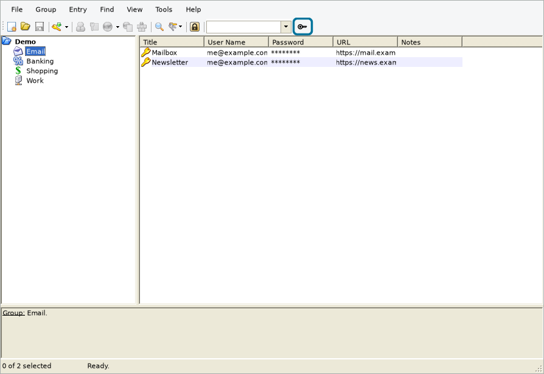
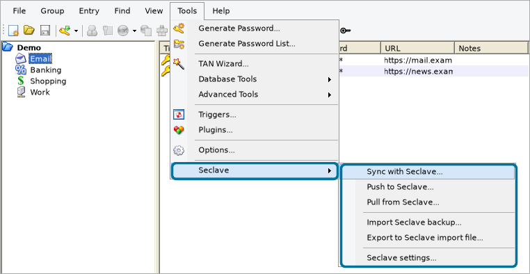
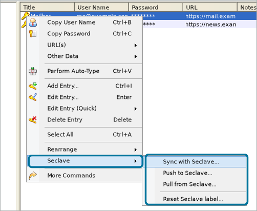
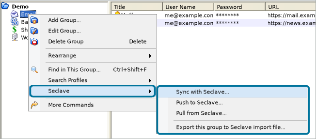
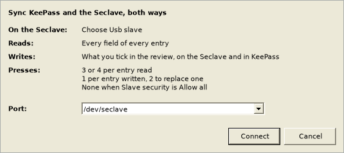
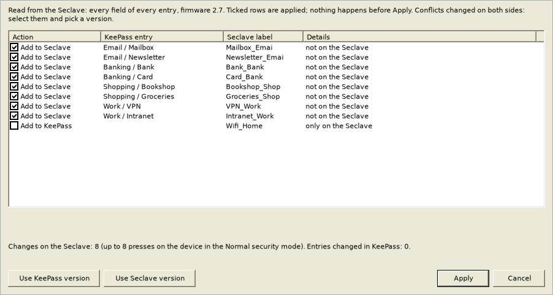
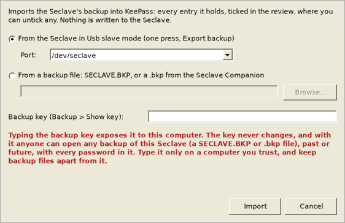
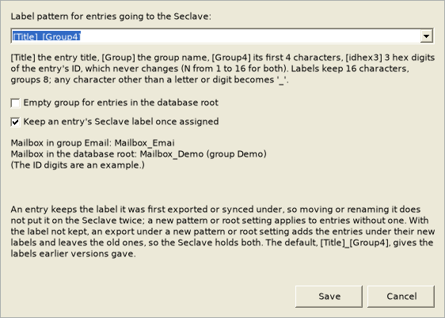

# Install keepass plugin
Download the latest release from https://github.com/seclave/seclave_keepassplugin/releases 
and install .plgx according to https://keepass.info/help/v2/plugins.html

Releases are built from the tagged source by this repository's release
workflow, which attests what it built. To check a download:

    gh attestation verify SeclavePlugin.plgx --owner seclave

## Linux: the Seclave's serial port

Linux lets only root and the `dialout` group open a serial port, and
ModemManager, where it runs, may probe a new one with AT commands, which
spoils the sync's first exchange with the Seclave. A udev rule sees to both:
it gives the Seclave's port to the user logged in at the computer, keeps
ModemManager off it, and names it `/dev/seclave`, which the sync lists
first. Download `install-udev-rule.sh` from the same release page (it is
also in this repository, under `linux/`), read it, and run it once:

    gh attestation verify install-udev-rule.sh --owner seclave
    sudo sh install-udev-rule.sh

It writes one file, `/etc/udev/rules.d/60-seclave-keepass.rules`, and has
udev read its rules again; nothing else changes. Then choose Usb slave on
the Seclave, again if it was in that mode already.

- `sh install-udev-rule.sh --print` shows the rule, and `--check` whether
  it is in place and the Seclave plugged in and yours to use; neither needs
  root.
- `sudo sh install-udev-rule.sh --remove` removes the rule.
- The Seclave Companion's Linux packages install the same rule, as
  `/usr/lib/udev/rules.d/60-seclave.rules`; with both, either can stay.
- On NixOS the script installs nothing and prints the rule to add to
  `services.udev.extraRules`. On a system without systemd-logind, where
  the rule cannot give the port to the user logged in, it says so: join
  the `dialout` group as well.
- Without the rule, be in the `dialout` group (`sudo usermod -aG dialout
  $USER`, then log out and in again) and pick the `/dev/ttyACM...` port the
  sync offers, which it knows by the Seclave's USB ids. ModemManager
  may then probe the port for a while after you choose Usb slave, and a
  sync in that time fails; wait and try again.

Windows and macOS need none of this, and neither does the export.

# Before you start

The plugin changes your KeePass database and your Seclave, so keep a copy
of both: a backup of the database file, and a backup of the Seclave
(Backup > Export on the Seclave). Every change is listed in a review before
anything is applied. Only Push to Seclave cannot show what it replaces, as
it does not read the Seclave: a change made there to an entry it writes is
lost.

The plugin is provided as is, without warranty of any kind; see
[LICENSE](LICENSE).

# Quick start

The plugin puts a Seclave submenu in three places, and a button on the
toolbar:

- **Tools > Seclave**, for the whole database: Sync with Seclave..., Push to
  Seclave..., Pull from Seclave..., Import Seclave backup..., Export to
  Seclave import file... and Seclave settings...;
- **Seclave** on the right-click menu of entries, for the selected ones:
  Sync, Push and Pull, and Reset Seclave label...;
- **Seclave** on the right-click menu of a group, for its entries and those
  of the groups in it: Sync, Push and Pull, and Export this group to Seclave
  import file...;
- **the Seclave button** at the end of KeePass's toolbar: Sync with
  Seclave....

Each command goes one way, or both:

| Command | Reads the Seclave | Writes the Seclave | Presses in the Normal security mode |
|---|---|---|---|
| Sync with Seclave... | every entry, or only the chosen ones | what changed in KeePass | 3 or 4 per entry read, 1 per entry written, 2 per replace |
| Push to Seclave... | nothing | the entries new or changed in KeePass since the last sync | 1 per entry written, 2 per replace |
| Pull from Seclave... | every entry, or only the chosen ones | nothing; it changes only KeePass | 3 or 4 per entry read |
| Import Seclave backup... | its backup, from the Seclave or a file | nothing; it changes only KeePass | 1, none from a file |
| Export to Seclave import file... | nothing | every entry, in the Seclave's import mode | none |

To sync:

1. On the Seclave, choose Usb slave. On Linux, install the udev rule first
   (see above).
2. In KeePass, click the Seclave button, or choose Sync with Seclave... in a
   Seclave submenu.
3. Check the port and click Connect; confirm on the Seclave when it asks.
   The plugin offers only the Seclave's ports, which it knows by the
   Seclave's USB ids, as "COM3 (Seclave)" say; if it finds none, type the
   port in.

   

4. The review shows what the sync would change, on the Seclave and in
   KeePass. Ticked rows are applied, and nothing changes until you click
   Apply. An entry that is only on the Seclave is offered for KeePass,
   unticked.

   

In the Normal security mode the Seclave asks for a press of its joystick for
every field it shows and every change it makes, so reading the whole Seclave
field by field takes three or four presses per entry. Without Allow all, use
the commands that need few: Push to Seclave... writes what you changed in
KeePass and reads nothing, Import Seclave backup... takes in what changed on
the Seclave with one press, and the right-click Sync and Pull read only the
entries you choose. To keep the whole Seclave a mirror of KeePass with Sync,
set Slave security to Allow all on the Seclave for the sync, and back to
Normal after it; "Using it" below says what Allow all lets any computer do
meanwhile.

Import Seclave backup... asks for the backup key, and says by the key field
what typing it means:

To export instead, choose import on the Seclave and use Export to Seclave
import file...; when it is done, check that the Seclave shows Import OK, and
unplug it.

The pictures show KeePass 2.60 on Linux; on Windows and macOS the button and
the items are in the same places.

# Using it

The plugin adds two ways to get KeePass entries onto a Seclave. The sync
over the Seclave's USB slave port is the recommended one. The export to the
Seclave's import volume is the fallback, for a first bulk load into an empty
Seclave, or when the serial port is not available.

**Why the sync is preferred.** The export writes every exported username,
password and note unencrypted to a file on a USB drive, and a wrong drive
that looks like the Seclave's would receive it; the sync writes no file
anywhere, as the entries go over the serial port straight into the Seclave.
In the Normal security mode the Seclave asks on its own screen before every
change the sync makes, and goes ahead only on a press of its joystick, which
no program on the computer can give; an import is one bulk load, and the
Seclave adds every new entry in it without asking about each. The sync sends
only what changed, after showing you the plan, so the Seclave and KeePass
stay in step and changes made on the Seclave come back; an import merges by
label and never deletes, so the Seclave drifts from KeePass over time. The
export also needs the Seclave in import mode, where it shows up as a drive
to the whole computer, while the sync uses the single serial port of the
Seclave's slave mode. The sync does need that port to be reachable (see
Requirements and notes below), and reading the whole Seclave takes a press
per field in the Normal security mode (below); the export needs no driver or
port setup and is the quickest way to fill an empty Seclave.

**Tools > Seclave > Sync with Seclave...** keeps the Seclave and KeePass in step
over the Seclave's USB slave port, in both directions; the button with the
Seclave key at the end of KeePass's toolbar does the same. Choose Usb slave
on the Seclave first. The plugin reads the Seclave, compares it
with KeePass and shows what it would change: entries to add or update on
the Seclave, and entries changed on the Seclave (a password you changed
there, say) to update in KeePass. Nothing changes until you press Apply.

- Each synced entry remembers what the Seclave last held for it, so the
  plugin can tell which side changed. When both did, it shows a conflict and
  you pick the version to keep; it never chooses for you.
- Before an entry is updated from the Seclave, KeePass's own history keeps
  the previous version, so the update can be undone from the entry's History
  tab. A database set to keep no history (Database Settings > History)
  keeps no old version either; the result says so.
- Nothing is deleted unless you tick it: an entry in the KeePass recycle bin
  is offered for deletion on the Seclave, and an entry that exists only on
  the Seclave is offered for adding to KeePass (under "From Seclave"). An
  entry the plugin could not read on the Seclave is never deleted.
- Web logins stored on the Seclave are left alone; a KeePass entry whose
  label is that of a web login is not synced.
- While one of the plugin's dialogs is open, KeePass holds off locking the
  workspace. If the database is closed all the same, the sync stops and
  says what was done.
- The plugin does not save the database; save it to keep the changes and the
  sync state.
- The first sync that changes anything adds an entry "Seclave sync key" to
  the database root. Its attachment is a random key the plugin uses to tell
  which synced entries changed; the entry is never exported or synced. If
  it is deleted, the next sync re-checks every synced entry: those that are
  the same in KeePass and on the Seclave are linked again, and those that
  differ are shown as conflicts for you to decide.

**How the Seclave is read.** Sync and Pull read every field of every entry,
one press per field in the Normal security mode, or, from the right-click
menus, only the chosen entries. An entry whose reading you decline on the
Seclave is shown as not read, and nothing about it is ticked. Push reads
nothing, and Import Seclave backup reads the backup, with one press.

In the Normal security mode the Seclave also asks for a press for every
entry it adds, updates or deletes; the review dialog says how many. With
Slave security set to Allow all it asks nothing, and an entry added under a
label the Seclave already has replaces that entry without a question.

**Keeping the Seclave a mirror of KeePass realistically needs Allow all for
the duration of the sync.** In the Normal security mode every change the
sync makes waits for a press of the Seclave's joystick, and so does every
field it reads. On the Seclave, choose Admin > Slave
security > Allow all, sync, and set Slave security back to Normal after the
sync. Careful: in Allow all mode any computer connected over USB can read
every label, group, username, password and note, and change entries,
without a confirmation on the Seclave. Use it only on a computer you trust,
and set Slave security back to Normal when you are done.

The plugin notices when the Seclave asks for confirmations, from how long
it takes to answer, and says so in the review, with the number of presses
the sync needs. Reading every field, it asks once, as soon as it notices,
whether to go on, or to stop and use Allow all, or Import Seclave backup and
Push to Seclave instead.

**Sync with Seclave...** on the right-click menu of selected entries, or of
a group (its entries and those of the groups in it), syncs just those
entries: the review shows them alone, and the sync writes only them. It
reads only those entries, field by field: four presses each in the Normal
security mode, and one for an entry the Seclave does not have, so a few
entries need no Allow all. It never deletes on the
Seclave, nor adds to KeePass an entry only on the Seclave; the sync of the
whole database does that. Entries in the recycle bin are not synced this
way, and an entry whose label belongs to another entry is left out.

**Pull from Seclave...**, in the Tools submenu for the whole database and on
the same right-click menus, reads as the sync does but changes only KeePass:
it takes in the changes made on the Seclave, offers a change made on both
sides as an unticked update in KeePass, and leaves out the changes made in
KeePass and the entries the Seclave does not have, which a sync or a push
writes to the Seclave. From the Tools submenu it also offers, unticked, the
entries only on the Seclave, as the sync does.

**Push to Seclave...**, in the Tools submenu for the whole database and on
the right-click menus for the chosen entries, writes the entries new or
changed in KeePass since the last sync, and reads nothing from the Seclave:
one press each in the Normal security mode, two to replace one already
there. Each replaces the entry under its label on the Seclave, so a change
made there to that entry is lost, and so is a web login or other entry that
has the same label; in the Normal security mode the Seclave asks before each
replace, with Allow all it does not. "Also write the entries unchanged since
the last sync" writes every chosen entry, to repair a Seclave. A push never
deletes. On firmware 2.6, a Seclave that already holds the label says so and
then asks whether to replace it, without telling the plugin the answer: the
plugin counts it as not replaced, so the change stays to write, and the next
sync, which reads the entry, finds out either way.

**Import Seclave backup...**, in the Tools submenu, reads the Seclave's
backup: from the Seclave in Usb slave mode, with one press, or from a backup
file, the SECLAVE.BKP that the Seclave's Backup > Export writes or a .bkp
that the Seclave Companion saved, with no Seclave attached. It needs the
backup key, which the Seclave shows under Backup > Show key; the plugin asks
for it each time and does not store it. The review shows every entry of the
backup ticked, to be brought into KeePass, except a change made on both
sides; untick what you do not want. It changes only KeePass. Typing the
backup key exposes it to the computer: the key never changes, and with it
anyone can open any backup of this Seclave, past or future, so type it only
on a computer you trust, and keep backup files apart from it.

**Tools > Seclave > Export to Seclave import file...** (and "Export this
group to Seclave import file..." in a group's Seclave submenu) is the fallback: it writes
every entry to the Seclave's import volume in one go. Choose import on the
Seclave first: it then shows up as a small drive labelled SECLAVE that holds
a file named SCIMPORT.STE. The plugin looks only at drives that the system's
own list of drives shows to be local removable disks: on Linux a FAT drive
on a removable USB disk, on Windows a removable drive (on USB, where Windows
tells), on macOS a local FAT disk. It never asks a network drive, or any
other drive, anything. It writes only to such a drive, only when exactly one
is present, and only when it is no larger than 2 MB (the Seclave's is about
256 KB). A drive that does not answer within 10 seconds is named, and
nothing is written. Before it writes, it names the drive and asks.

The import file, `seclave.imp`, holds the entries unencrypted: usernames,
passwords and notes. It exists only in the Seclave's memory, and only while
the Seclave is in import mode, so when the export is done, check that the
Seclave shows Import OK, then unplug it. If writing fails part way, the
Seclave may already hold part of the file: unplug it, choose import on it
again, and export again.

The Seclave merges an import into what it already holds: it adds new labels,
and for a label it already has it keeps its own version or takes the
imported one, as you choose on the device. An import never deletes anything
on the Seclave. When you export one group, an entry elsewhere in the
database with the same label is probably on the Seclave already; the export
warns about it, and the import keeps one of the two.

The export records on each entry the label it wrote it under (see Labels on
the Seclave below), which marks the database changed: save it to keep the
labels.

What the Seclave can hold, and what the plugin does about the rest:

- Usernames and passwords hold 50 characters on the Seclave and notes 83,
  in Latin-1.
- A password the Seclave would hold changed, cut short because it is longer
  than 50 characters or with `?` for a character outside Latin-1, stops an
  export and is never synced, since the Seclave would type a wrong password.
- A username or notes the Seclave would cut, or hold with `?` in place of a
  character outside Latin-1, makes the export ask first; in the sync such a
  row is not ticked, and says what would change.
- A username, password or notes that refers to another entry (`{REF:...}`)
  or to a field (`{USERNAME}`, `{S:Pin}` and the like) goes to the Seclave
  as the value KeePass fills in, and what the Seclave can hold is checked on
  that value. When the entry referred to changes, the next sync updates
  every entry that refers to it. A change made on the Seclave to such a
  value is not taken into KeePass, where it would replace the reference: the
  sync shows the entry and leaves it alone; make the change in KeePass, in
  the entry referred to.
- Any other KeePass placeholder, such as `{CLIPBOARD}` or `{DT_SIMPLE}`,
  and a reference to an entry that no longer exists, stop an export and keep
  the entry from being synced: the Seclave would hold the placeholder text.
- So does a reference that KeePass cannot follow to its end, because it
  leads back to itself or goes more than 11 steps deep: KeePass leaves out
  what it cannot follow, and the Seclave would hold the value with that
  part missing.
- The group name `wwwfill` is the Seclave's own, for its web logins; an
  entry in a group of that name stops an export and is never synced.

Requirements and notes:

- Tested with KeePass 2.60. The labels and the sync state are kept in each
  entry's custom data, which the KDBX 4 file format holds (the format current
  KeePass versions save in any case).
- On Linux the sync needs the Seclave's udev rule, or the `dialout` group;
  see "Linux: the Seclave's serial port" above. On Windows the Seclave
  appears as a COM port; on macOS as `/dev/cu.usbmodem...`, and as the
  plugin cannot tell which of those is the Seclave's, it offers them all.

# Labels on the Seclave

The Seclave knows each entry by a label of up to 16 characters: letters
(including a few Latin-1 ones such as a-ring and o-umlaut), digits and `_`.
Any other character becomes `_`, and upper and lower case count as the same.
**Tools > Seclave > Seclave settings...** sets how labels are made, for both the
export and the sync, with a pattern of literal text and these tokens:

- `[Title]` - the entry's title, as typed (a reference in it is not
  followed);
- `[Group]` - the name of the entry's group; `[Group4]` its first 4
  characters (any number from 1 to 16);
- `[idhex3]` - the first 3 hex digits of the entry's KeePass ID (any number
  from 1 to 16), which never changes, so the label stays the same across
  exports even if the password or notes change.

A pattern must contain `[Title]` or an `[idhexN]`; token names are
case-sensitive. The dialog shows an example and will not save a pattern it
cannot use. The default, `[Title]_[Group4]`, gives the same labels as every
earlier version of the plugin; for example `Mailbox_Emai` for the entry
Mailbox in the group Email.

**An entry keeps its label.** The first export or sync records the label on
the entry, and later exports and syncs use it even after you move or rename
the entry, so the Seclave does not get the entry twice. The entry's group on
the Seclave still follows its KeePass group: an export writes the new group,
and the sync updates it, ticked in the review (two presses in the Normal
security mode). The sync compares groups as the plugin writes them and
regardless of case, so a group the Seclave has as `my-bank` is the KeePass
group my-bank, which the plugin writes as `my_bank`; the Seclave keeps its
own spelling. A group changed on the Seclave is shown but not applied in
KeePass; once that row is applied, the next sync offers to change the group
back on the Seclave. A copy of an entry (KeePass's Duplicate
Entry, or copy and paste) does not take the original's label; it gets its
own. **Reset Seclave label...** on selected entries forgets their labels, so
that the pattern applies to them again; the Seclave keeps any copy under the
old label until you delete it there. Untick **Keep an entry's Seclave label
once assigned** to have the export follow the pattern every time instead,
for example to have labels follow your groups; each such change then puts
the entry on the Seclave under a new label, next to the old one.

**Empty group for entries in the database root** (off by default) gives
entries directly in the root an empty group instead of the root's name, both
on the Seclave and in `[Group]`. A separator in the pattern stays:
`[Title]_[Group4]` gives `Mailbox_` for such an entry. For root entries
already synced, the next sync offers to change their group on the Seclave.

Labels are cut to 16 characters, so put an `[idhexN]` early if titles are
long. Two entries that end up with the same label, an empty label, or a
password the Seclave cannot store stop an export, with the label and both
entries named; the sync leaves such entries out and says why.

Before you change the pattern or the root setting:

- **Entries with a label keep it.** A new pattern or root setting applies
  only to entries that have none yet. When the sync finds such an entry on
  the Seclave under the label the previous settings or the default pattern
  give it, it keeps that label rather than adding the entry again.
- **An export does not rename.** The Seclave merges an import and never
  deletes, so an entry exported under a new label is on the Seclave twice,
  under the old label and the new. Delete the old one on the Seclave, or
  keep the settings.
- The settings are KeePass's, not the database's: they apply to every
  database you open.

# Building the release .plgx

The supported build is the Podman path (only needs podman):

`./compile_on_podman.sh`

This packages the plugin source into `output/SeclavePlugin.plgx` using
`keepass2 --plgx-create` (no compiler needed - KeePass compiles the plgx on
the user's machine when loading it). Releases are built the same way by the
release workflow.

# Development

[CONTRIBUTING.md](CONTRIBUTING.md) describes how the source is laid out, the
C# 3 rule and how to check it, and building.

# License

MIT — see the [LICENSE](LICENSE) file.

Seclave is a trademark of Seclave AB. This license grants no trademark rights.
